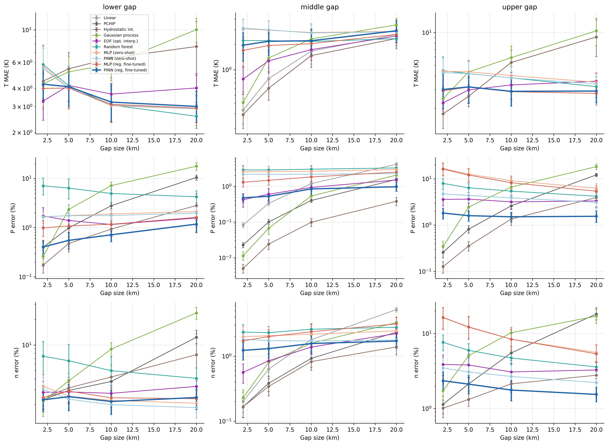
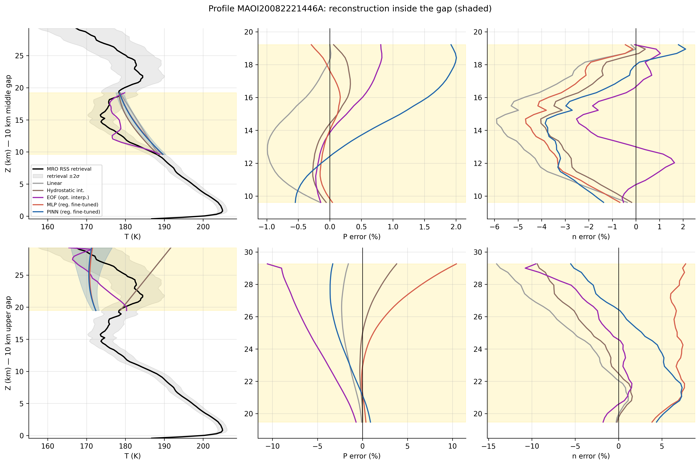
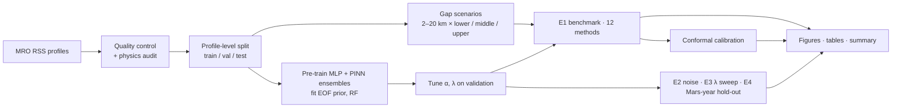
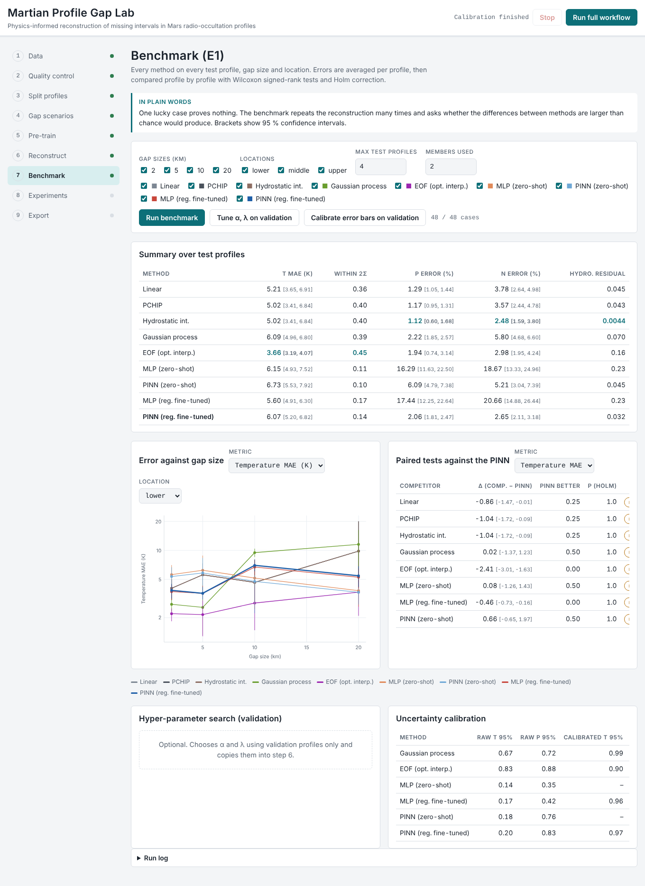

<div align="center">

# Physics-Informed Reconstruction of Missing Intervals in Martian Radio-Occultation Profiles

**Shailendra Dabral · Keshav Aggarwal · Soumyaneal Banerjee**

[](https://github.com/ShailendraDabral/Mars-atmosphere/actions/workflows/tests.yml)
[](https://shailendradabral.github.io/Mars-atmosphere/)
[](pyproject.toml)
[](https://pytorch.org/)
[](LICENSE)
[](data/README.md)

[**Interactive simulator**](https://shailendradabral.github.io/Mars-atmosphere/) ·
[Results](results/) ·
[Notebooks](notebooks/) ·
[Data](data/) ·
[Citation](#citation)

</div>

---

## Abstract

Radio-occultation (RO) soundings from the Mars Reconnaissance Orbiter (MRO) Radio Science experiment provide
vertical profiles of temperature, pressure and number density, but individual profiles can contain missing or
unreliable intervals. We benchmark **twelve methods** for reconstructing such gaps — interpolation, hydrostatic
integration, Gaussian processes, EOF optimal interpolation, random forests, and data-only (MLP) and
**physics-informed neural networks (PINNs)** under zero-shot, fine-tuned and L2-SP-regularised fine-tuning
regimes. The PINN enforces the ideal-gas law exactly through its output parameterisation and penalises violations
of hydrostatic balance in geopotential coordinates.

On **185 MRO RSS profiles** (Mars years 29–31) with a leakage-free, profile-level split and **330 synthetic gap
cases** (2–20 km; lower, middle and upper atmosphere), the physics constraint makes **pressure and density**
reconstructions markedly more accurate and physically self-consistent than an identical data-only network
(pressure error 1.0 % vs 4.4 %; hydrostatic residual 0.010 vs 0.12). **Temperature** inside a gap, however, is
not determined by hydrostatics: the best temperature skill comes from statistical priors learned across profiles
(EOF optimal interpolation, 2.78 K MAE), and the PINN is statistically indistinguishable from it. Split-conformal
calibration on validation profiles brings the PINN's 95 % intervals from 73 % to 92 % empirical coverage.

<p align="center">
  
  <br><em>Reconstruction error versus gap size, by gap location (test profiles, 95 % bootstrap CIs).</em>
</p>

## Contents

- [Key results](#key-results)
- [Method](#method)
- [Repository structure](#repository-structure)
- [Installation](#installation)
- [Reproducing the results](#reproducing-the-results)
- [Interactive simulator](#interactive-simulator)
- [Data](#data)
- [Configuration](#configuration)
- [Testing](#testing)
- [Limitations](#limitations)
- [Citation](#citation)
- [License and acknowledgements](#license-and-acknowledgements)

## Key results

Test set: 28 unseen profiles, 330 gap cases. Mean over profiles; brackets give 95 % profile-level bootstrap CIs.
Full table: [`results/tables/summary_overall.csv`](results/tables/summary_overall.csv); all statistical statements:
[`results/results_summary.md`](results/results_summary.md).

| Method | Uses other profiles | Uses physics | T MAE (K) | P error (%) | n error (%) | Hydrostatic residual (RMS) |
|---|:-:|:-:|---|---:|---:|---:|
| Linear | | | 3.97 [3.28, 4.74] | 2.92 | 4.55 | 0.070 |
| PCHIP | | | 3.91 [3.25, 4.66] | 2.63 | 4.23 | 0.064 |
| Hydrostatic integration | | ✓ | 3.91 [3.25, 4.66] | 0.86 | 2.25 | 0.0031 |
| Gaussian process | | | 4.61 [3.93, 5.28] | 4.67 | 6.39 | 0.115 |
| EOF optimal interpolation | ✓ | | **2.78 [2.43, 3.15]** | 1.90 | 2.52 | 0.165 |
| Random forest | ✓ | | 3.36 [2.82, 3.94] | 4.85 | 4.54 | 0.378 |
| MLP (zero-shot) | ✓ | | 3.63 [3.02, 4.33] | 5.22 | 5.08 | 0.119 |
| PINN (zero-shot) | ✓ | ✓ | 3.58 [2.96, 4.27] | 2.68 | 2.30 | 0.012 |
| MLP (fine-tuned) | ✓ | | 3.33 [2.78, 3.97] | 7.58 | 7.94 | 0.167 |
| PINN (fine-tuned) | ✓ | ✓ | 3.18 [2.70, 3.72] | **0.83** | **1.72** | 0.0031 |
| MLP (L2-SP fine-tuned) | ✓ | | 2.85 [2.32, 3.45] | 4.44 | 5.10 | 0.120 |
| **PINN (L2-SP fine-tuned)** | ✓ | ✓ | 3.00 [2.43, 3.64] | 1.01 | 1.92 | 0.010 |

Reference retrieval hydrostatic-residual floor: 0.0016.

**Findings** (paired Wilcoxon tests, Holm-corrected, α = 0.05):

1. **Pressure and density.** The regularised PINN is significantly better than every data-only method for pressure,
   and is statistically tied with exact hydrostatic integration.
2. **Temperature.** The regularised PINN beats interpolation, hydrostatic integration and the GP, but is not
   significantly different from EOF optimal interpolation or the data-only networks: the physics constrains
   *P* given *T*, not *T* itself.
3. **Physical consistency.** Hydrostatic residuals of the PINN are an order of magnitude below those of the matched
   data-only MLP.
4. **Uncertainty.** Raw ensemble intervals are over-confident (73 % coverage at nominal 95 %); split-conformal
   calibration fixes coverage (92 % T, 94 % ln P).

<p align="center">
  
</p>

## Method

**Vertical coordinate.** Geopotential height *Z* = Φ / g₀ (g₀ = 3.71 m s⁻²), in which hydrostatic balance is exact.

**Network.** An MLP maps (*Z*, latitude, sin/cos longitude, sin/cos *L*ₛ) to (*T*, ln *P*). Number density is derived,
so the ideal-gas law holds by construction:

$$n = \frac{P}{k_B T}$$

**Physics loss.** Hydrostatic balance, $\dfrac{d\ln P}{dZ} = -\dfrac{\bar m g_0}{k_B T}$, is enforced through the
dimensionless residual

$$r = H_{\mathrm{ref}}\,\frac{d\ln P}{dZ} + \frac{T_{\mathrm{ref}}}{T}, \qquad T_{\mathrm{ref}} = 200\ \mathrm{K},\ H_{\mathrm{ref}} \approx 10.3\ \mathrm{km},$$

evaluated by automatic differentiation at collocation points. The training loss is

$$\mathcal{L} = \mathcal{L}_{\mathrm{data}}^{\sigma\text{-weighted}} + \lambda\,\overline{r^2} + \alpha\,\lVert\theta - \theta_{\mathrm{pre}}\rVert^2 ,$$

where the last (L2-SP) term applies only during per-profile regularised fine-tuning. λ = 0 gives the matched
data-only MLP. α and λ are selected on validation profiles only.

**Protocol.**



| Experiment | Question |
|---|---|
| **E1** Main benchmark | Accuracy and physical consistency of all methods across gap sizes and locations |
| **E2** Noise robustness | Sensitivity to added retrieval noise (0, 2σ, 5σ) on the observed levels |
| **E3** Physics-weight sweep | Effect of λ ∈ {0, 0.01, …, 100} |
| **E4** Mars-year hold-out | Transfer to an unseen observing campaign |

Statistics: profile-level bootstrap CIs (5000 resamples), paired Wilcoxon signed-rank tests with Holm correction,
split-conformal calibration of predictive intervals on validation profiles.

## Repository structure

```
Mars-atmosphere/
├── src/marspinn/            Python package (config, physics, data, baselines, nn, benchmark, metrics, plots, pipeline, CLI)
├── configs/                 YAML experiment configs: quick, demo, synthetic_full, paper
├── notebooks/
│   ├── 01_mro_rss_pinn_reconstruction.ipynb                  self-contained experiment notebook (clean)
│   └── 02_mro_rss_pinn_reconstruction_executed_kaggle.ipynb  executed record of the reported run
├── data/
│   ├── processed/           MRO RSS profiles used in the study (levels + per-profile metadata)
│   └── profile_ids.txt      the 185 profile identifiers
├── results/                 reported results: figures/, tables/, results_summary.md
├── paper/figures/           figures prepared for the manuscript
├── docs/                    interactive browser simulator (GitHub Pages)
├── scripts/                 dataset builder and convenience scripts
├── tests/                   pytest suite and JavaScript engine tests
├── CITATION.cff
└── pyproject.toml
```

## Installation

Requires Python ≥ 3.9.

```bash
git clone https://github.com/ShailendraDabral/Mars-atmosphere.git
cd Mars-atmosphere
python -m venv .venv
source .venv/bin/activate          # Windows: .venv\Scripts\activate
pip install torch --index-url https://download.pytorch.org/whl/cpu   # or a CUDA build
pip install -e ".[dev]"
```

## Reproducing the results

The reported results were produced by
[`notebooks/02_mro_rss_pinn_reconstruction_executed_kaggle.ipynb`](notebooks/02_mro_rss_pinn_reconstruction_executed_kaggle.ipynb)
(Kaggle GPU, 394.7 min). The same protocol is available as a package and command-line tool:

```bash
marspinn run --config configs/paper.yaml          # full protocol on the real data (GPU recommended, ~6–7 h)
marspinn run --config configs/quick.yaml          # smoke test on synthetic data (~3 min on a CPU)
marspinn run --config configs/demo.yaml           # all experiments, medium size, synthetic data
```

Run selected steps or override settings:

```bash
marspinn steps                                                     # list steps and dependencies
marspinn run --config configs/paper.yaml --steps e1 report
marspinn run --config configs/quick.yaml --set GAP_SIZES_KM=[10,20] LAMBDA_PHYS=10 SEEDS=[0,1,2]
marspinn audit --csv data/processed/mro_tps_combined.csv          # quality control + physics audit only
marspinn synth --out data/synthetic_tps.csv                       # synthetic archive in the MRO format
```

From Python:

```python
from marspinn import load_config, Pipeline

cfg = load_config("configs/paper.yaml", ["SEEDS=[0,1,2]"])
results = Pipeline(cfg).run(["data", "split", "pretrain", "tune", "e1", "report"])
print(results["S_OVERALL"])
```

Each run writes to `OUTPUT_DIR`:

```
results/<name>/
├── run_config.yaml                 exact settings used
├── data_audit.json                 QC and physics audit
├── splits.json                     profile IDs per split
├── selected_hyperparameters.json
├── figures/                        fig01 … fig10 (PNG + PDF)
├── tables/                         summary_*.csv, significance_*.csv, uncertainty_summary.csv, LaTeX tables
├── results_summary.md              auto-generated; claims only what the tests support
└── checkpoints/, raw/              cached networks and pointwise predictions (runs resume from here)
```

## Interactive simulator

[**shailendradabral.github.io/Mars-atmosphere**](https://shailendradabral.github.io/Mars-atmosphere/) runs the
complete workflow in the browser — data generation or CSV upload, QC, splits, gaps, network training,
reconstruction, benchmark, statistics, calibration and the E2–E4 experiments — in plain JavaScript with no server
and no dependencies. Default settings are smaller than the paper's so a full run takes one to three minutes; any
setting can be exported as a YAML config for the Python pipeline. It opens on an overview of the reported results
and includes a **Gap challenge**: draw your own guess across a hidden interval and see how it ranks against the
reconstruction methods.

<p align="center">
  
</p>

Run it locally with `scripts/serve_simulator.sh` (then open <http://localhost:8000>) or open `docs/index.html`
directly. See [`docs/README.md`](docs/README.md).

## Data

The study uses the MRO Radio Science temperature–pressure profiles, **`MRO-M-RSS-5-TPS-V1.0`** (D. P. Hinson,
NASA Planetary Data System, Atmospheres Node). The processed tables used in the paper — 185 pre-dawn ingress
profiles from Mars years 29–31 — are included in [`data/processed/`](data/processed/); see
[`data/README.md`](data/README.md) for provenance, column definitions and how to rebuild them from the PDS
products with [`scripts/build_mro_dataset.py`](scripts/build_mro_dataset.py).

The pipeline also includes a physically consistent **synthetic** generator (`marspinn.synthetic`) with the same
columns and coverage, used for tests, the simulator and quick experiments. Synthetic results are for development
only; quote results on the real data.

## Configuration

All settings live in one flat dictionary; defaults (`src/marspinn/config.py`) reproduce the paper protocol, and
YAML files or `--set KEY=VALUE` override individual entries.

| Key | Default | Meaning |
|---|---|---|
| `DATA_SOURCE` | `synthetic` | `synthetic` or `csv` |
| `DATA_LEVELS` | `data/processed/mro_tps_combined.csv` | input CSV when `DATA_SOURCE: csv` |
| `SIGMA_T_MAX`, `MIN_LEVELS` | `5.0`, `40` | quality control |
| `SPLIT_FRACS`, `SPLIT_SEED` | `[0.7, 0.15, 0.15]`, `2024` | profile-level split |
| `GAP_SIZES_KM`, `GAP_LOCATIONS` | `[2, 5, 10, 20]`, all three | gap scenarios |
| `SEEDS` | `[0, 1, 2, 3, 4]` | ensemble members |
| `HIDDEN`, `DEPTH` | `64`, `4` | network size |
| `PRETRAIN_EPOCHS`, `PRETRAIN_LR` | `3000`, `2e-3` | pre-training |
| `LAMBDA_PHYS` | `1.0` | physics weight in pre-training and plain fine-tuning |
| `FINETUNE_STEPS`, `FINETUNE_LR` | `400`, `5e-4` | per-profile fine-tuning |
| `TUNE_ALPHAS`, `TUNE_LAMBDAS`, `TUNE_ES` | grids | validation search for regularised fine-tuning |
| `RUN_NOISE`, `RUN_LAMBDA_SWEEP`, `RUN_YEAR_HOLDOUT` | `true` | enable E2, E3, E4 |
| `N_BOOT`, `ALPHA` | `5000`, `0.05` | statistics |
| `DEVICE` | `auto` | `cpu`, `cuda` or `auto` |

## Testing

```bash
pytest -q                        # physics, baselines, gradients, statistics, tiny end-to-end run
node tests/test_sim_core.mjs     # simulator engine: physics audit, gradient check, short training
```

Both suites run on every push via GitHub Actions.

## Limitations

- **Scope.** All profiles are pre-dawn (≈ 03–05 LTST) ingress occultations in northern spring and summer
  (*L*ₛ ≈ 21°–142°), between about 13° S and 69° N.
- **Reference is a retrieval.** The reference profiles were themselves derived with hydrostatic balance and the
  ideal-gas law, so physical-consistency metrics measure agreement with the retrieval physics.
- **Physics constrains P given T, not T.** Temperature inside a gap comes from the learned cross-profile prior.
- **Synthetic gaps.** Gaps are imposed on complete profiles; real data loss may be structured differently.
- **Trimmed top.** Levels with σ_T > 5 K (upper-boundary initialisation zone) are excluded.
- **Confounded campaigns.** Mars year, season and latitude change together between campaigns, so E4 cannot
  separate interannual, seasonal and latitudinal transfer.

## Citation

If you use this code or results, please cite the software (see [`CITATION.cff`](CITATION.cff)) and the data:

```bibtex
@software{dabral_mars_pinn_2026,
  author  = {Dabral, Shailendra and Aggarwal, Keshav and Banerjee, Soumyaneal},
  title   = {Physics-informed reconstruction of missing intervals in Martian radio-occultation profiles},
  year    = {2026},
  version = {1.0.0},
  url     = {https://github.com/ShailendraDabral/Mars-atmosphere},
  license = {MIT}
}

@misc{hinson_mro_rss_tps,
  author       = {Hinson, D. P.},
  title        = {{MRO} Radio Science Temperature--Pressure Profiles, {MRO-M-RSS-5-TPS-V1.0}},
  howpublished = {NASA Planetary Data System, Atmospheres Node}
}
```

## License and acknowledgements

Code is released under the [MIT License](LICENSE). The MRO Radio Science data are provided by NASA's Planetary
Data System; we thank D. P. Hinson and the MRO Radio Science team for producing and archiving the retrievals.
