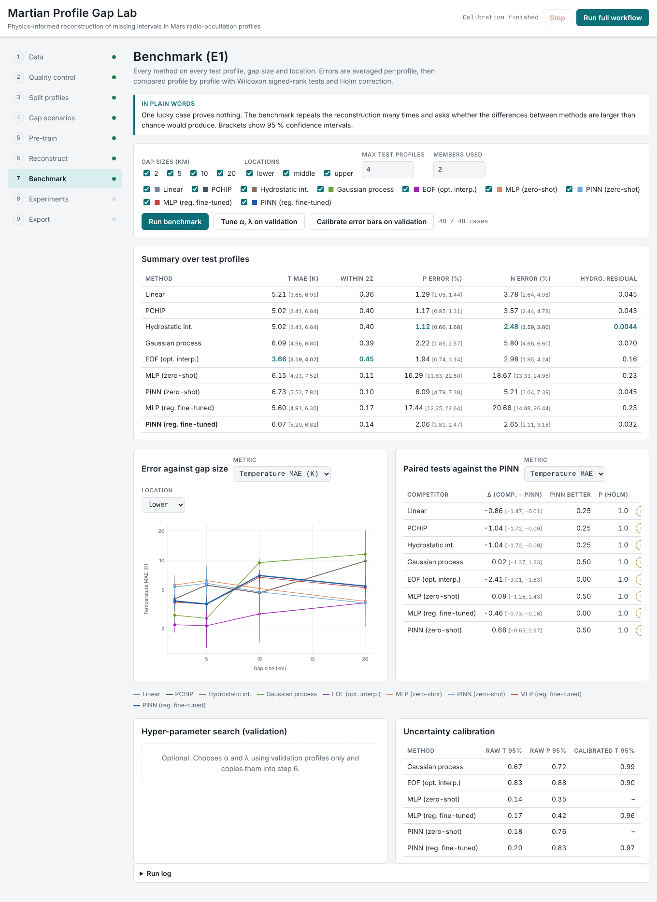
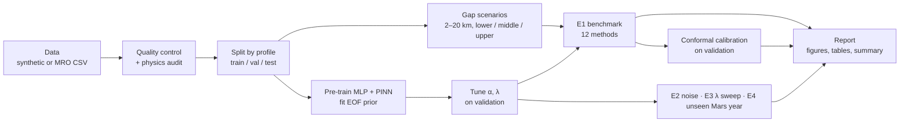
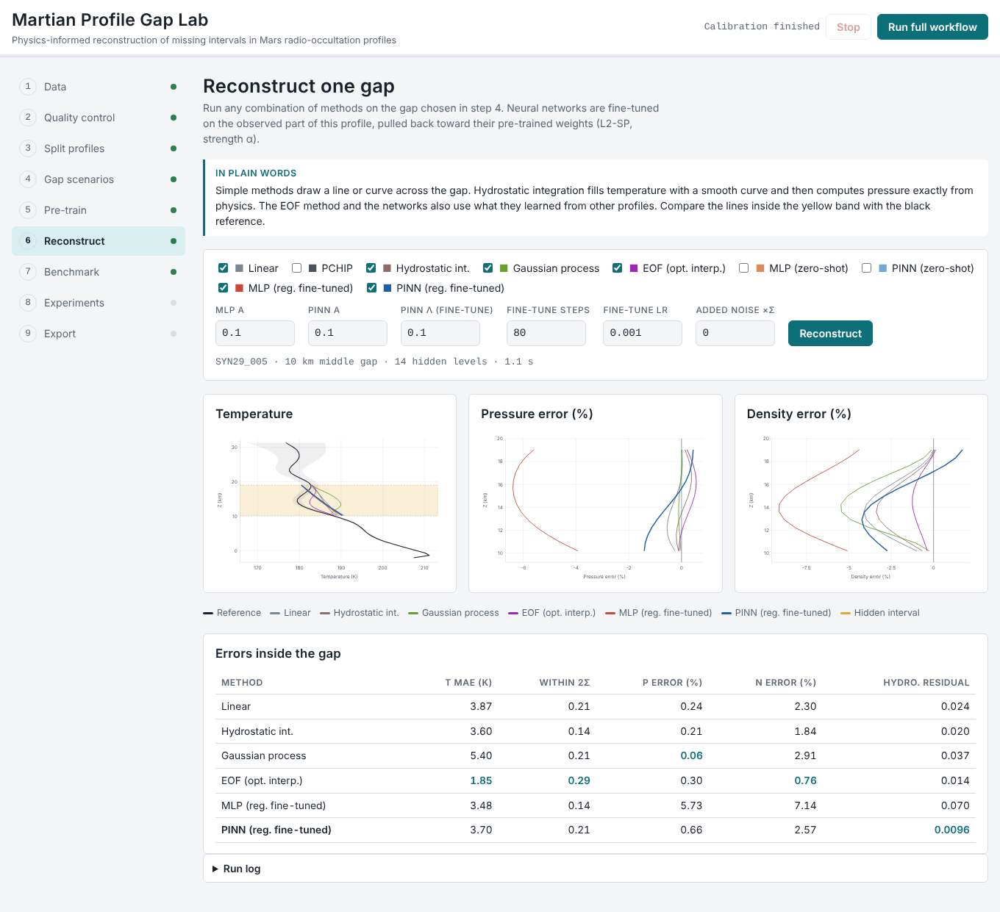
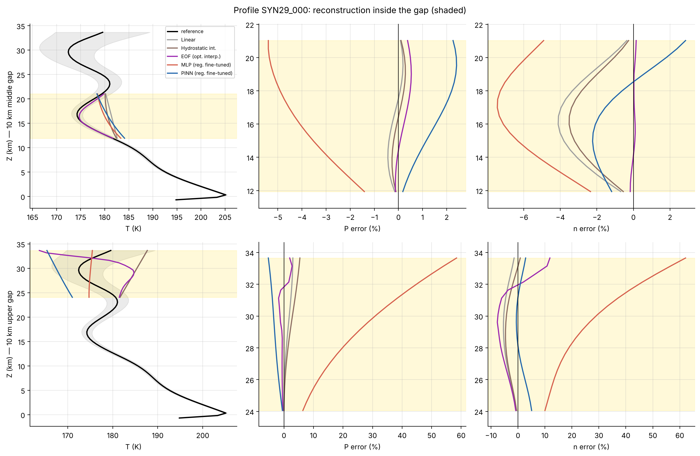

# Martian Profile Gap Lab https://shailendradabral.github.io/Mars-atmosphere/

**Physics-informed reconstruction of missing intervals in Martian radio-occultation temperature and pressure profiles.**

Authors: Shailendra Dabral, Keshav Agrawal · License: MIT

This repository contains the complete workflow of the study in two forms you can control:

| | What it is | How to use it |
|---|---|---|
| **Interactive simulator** (`docs/`) | A web app that runs the whole workflow in your browser: data, quality control, splits, gaps, neural-network training, reconstruction, benchmark, statistics, calibration and robustness experiments. No installation. | Open `docs/index.html`, or the GitHub Pages site once enabled |
| **Python pipeline** (`src/marspinn/`) | The research code behind the paper, as a package with a command-line tool. Every setting is in a YAML config and every step can be run on its own. | `marspinn run --config configs/quick.yaml` |

Both run on **synthetic** Mars profiles out of the box and on the **real** MRO Radio Science data when you supply it.



---

## The idea in plain words

Spacecraft around Mars measure how temperature and pressure change with height by watching a radio signal bend as it
passes through the thin atmosphere (*radio occultation*). Sometimes a stretch of a profile is missing or unreliable.
We compare twelve ways of filling in the missing stretch. One of them is a **physics-informed neural network (PINN)**:
a neural network that is also penalised whenever its output breaks **hydrostatic balance** (pressure at any height
supports the weight of the air above). The **ideal-gas law** (pressure = density × Boltzmann constant × temperature)
is built in exactly.

The main finding: the physics makes **pressure and density** reconstructions far more accurate and self-consistent
than an identical network without physics, but it does not by itself tell you the **temperature** — for that, the
statistical knowledge learned from many profiles matters most.

---

## The workflow



| Step | Python step | Simulator step | What happens |
|---|---|---|---|
| Data | `data` | 1 | Load the MRO CSV or generate a synthetic archive with the same columns and coverage |
| Quality control | `data` | 2 | Drop levels with σ_T > 5 K (top initialisation zone), require monotonic height and ≥ 40 levels; recover the retrieval's molecular mass and the hydrostatic residual floor |
| Split | `split` | 3 | Whole profiles → train / validation / test, stratified by Mars year |
| Gaps | `split` | 4 | Hide 2, 5, 10 or 20 km at the bottom, middle or top of each test profile |
| Pre-train | `pretrain` | 5 | Train MLP (λ = 0) and PINN (λ > 0) ensembles on training profiles; fit EOF prior and random forest |
| Tune | `tune` | 7 (button) | Choose L2-SP strength α and physics weight λ on validation profiles only |
| Benchmark E1 | `e1` | 6, 7 | All methods on all test cases; profile-level bootstrap CIs; paired Wilcoxon tests with Holm correction |
| Calibration | `calibrate` | 7 (button) | Split-conformal rescaling of predictive intervals, fitted on validation profiles |
| E2, E3, E4 | `e2`, `e3`, `e4` | 8 | Noise robustness, physics-weight sensitivity, Mars-year hold-out |
| Report | `report` | 9 | Figures (PNG/PDF), CSV and LaTeX tables, auto-generated results summary |

### Methods compared

| Method | Uses other profiles | Uses physics | Uncertainty |
|---|---|---|---|
| Linear / PCHIP interpolation | no | no | no |
| Hydrostatic integration (PCHIP T, exact ln P) | no | yes (exact) | no |
| Gaussian process | no | no | yes |
| EOF optimal interpolation | yes | no | yes |
| Random forest (Python only) | yes | no | no |
| MLP / PINN zero-shot | yes | PINN | ensemble |
| MLP / PINN fine-tuned (plain, Python) | yes | PINN | ensemble |
| **MLP / PINN regularised fine-tuning (L2-SP)** | yes | PINN | ensemble |

---

## 1. Interactive simulator

**Run locally:** `scripts/serve_simulator.sh` then open <http://localhost:8000>, or simply double-click
`docs/index.html`.

**Publish on GitHub Pages:** after pushing, go to *Settings → Pages → Source: GitHub Actions*. The workflow
`.github/workflows/pages.yml` deploys `docs/` on every push to `main`. The site appears at
[`https://<user>.github.io/<repo>/`](https://shailendradabral.github.io/Mars-atmosphere/).

What you can control:

- **Data:** number of profiles per Mars year, random seed, retrieval-noise level, or upload the real CSV.
- **Quality control:** σ_T threshold and minimum profile length.
- **Splits:** train / validation / test fractions and seed.
- **Gaps:** test profile, gap size (1–25 km), location, minimum observed extent.
- **Networks:** width, depth, ensemble size, training steps, learning rate, batch size, physics weight λ.
- **Reconstruction:** which methods, L2-SP strength α for each family, fine-tuning λ, steps, learning rate, added noise.
- **Benchmark:** gap sizes, locations, number of test profiles, methods; tuning on validation; conformal calibration.
- **Experiments:** noise multipliers (E2), λ values (E3), profiles per held-out year (E4).
- **Export:** a YAML config for the Python pipeline, benchmark tables (CSV), all results (JSON), the dataset (CSV).

Everything runs in the browser (plain JavaScript, no server, no external libraries). The neural networks use
hand-written forward-mode derivatives for d ln P / dZ and reverse-mode gradients, verified against finite
differences in `tests/test_sim_core.mjs`. Default settings are smaller than the paper's so that a full run takes
about one to three minutes; *Run full workflow* chains steps 1–7 with the current settings.



---

## 2. Python pipeline

### Install

```bash
python -m venv .venv && source .venv/bin/activate      # Windows: .venv\Scripts\activate
pip install torch --index-url https://download.pytorch.org/whl/cpu   # or the CUDA build for a GPU
pip install -e ".[dev]"
```

### Run

```bash
marspinn steps                                   # list steps and their dependencies
marspinn run --config configs/quick.yaml         # whole workflow, synthetic data, ~3 min on a CPU
marspinn run --config configs/demo.yaml          # all experiments, medium size
marspinn run --config configs/paper.yaml         # paper protocol on the real data (GPU recommended, ~6-7 h)

# control individual steps and settings
marspinn run --config configs/quick.yaml --steps e1 report
marspinn run --config configs/quick.yaml --set GAP_SIZES_KM=[10,20] LAMBDA_PHYS=10 SEEDS=[0,1,2]
marspinn run --csv data/mro_tps_combined.csv --quick

# utilities
marspinn synth --out data/synthetic_tps.csv      # write a synthetic archive in the MRO CSV format
marspinn audit --csv data/mro_tps_combined.csv   # quality control + physics audit only
```

From Python:

```python
from marspinn import load_config, Pipeline
cfg = load_config("configs/quick.yaml", ["SEEDS=[0,1,2]"])
results = Pipeline(cfg).run(["data", "split", "pretrain", "tune", "e1", "report"])
print(results["S_OVERALL"])
```

Results are cached per case and per checkpoint in `OUTPUT_DIR`, so an interrupted run resumes where it stopped.
Delete the output folder (or change `OUTPUT_DIR`) after changing data or model settings.

### Outputs

```
results/<name>/
  run_config.yaml            the exact settings used
  data_audit.json            QC and physics audit
  splits.json                profile IDs per group
  selected_hyperparameters.json
  figures/                   fig01 … fig10 (PNG + PDF)
  tables/                    summary_*.csv, significance_*.csv, uncertainty_summary.csv, table1_main_results.tex
  results_summary.md         auto-generated text; claims only what the tests support
  checkpoints/, raw/         cached networks, training histories, pointwise predictions
```



### Configuration reference (main keys)

| Key | Default | Meaning |
|---|---|---|
| `DATA_SOURCE` | `synthetic` | `synthetic` or `csv` |
| `SYNTH_PROFILES_PER_YEAR` | `[65, 46, 73]` | synthetic profiles in MY 29, 30, 31 |
| `SIGMA_T_MAX`, `MIN_LEVELS` | `5.0`, `40` | quality control |
| `SPLIT_FRACS`, `SPLIT_SEED` | `[0.7, 0.15, 0.15]`, `2024` | profile-level split |
| `GAP_SIZES_KM`, `GAP_LOCATIONS` | `[2,5,10,20]`, all three | gap scenarios |
| `SEEDS` | `[0..4]` | ensemble members |
| `HIDDEN`, `DEPTH` | `64`, `4` | network size |
| `PRETRAIN_EPOCHS`, `PRETRAIN_LR` | `3000`, `2e-3` | pre-training |
| `LAMBDA_PHYS` | `1.0` | physics weight in pre-training and plain fine-tuning |
| `FINETUNE_STEPS`, `FINETUNE_LR` | `400`, `5e-4` | per-profile fine-tuning |
| `TUNE_ALPHAS`, `TUNE_LAMBDAS`, `TUNE_ES` | grids | validation search for regularised fine-tuning |
| `HP_OVERRIDE` | `null` | fix α, λ, early stopping and skip tuning |
| `RUN_NOISE`, `RUN_LAMBDA_SWEEP`, `RUN_YEAR_HOLDOUT` | `true` | enable E2, E3, E4 |
| `N_BOOT`, `ALPHA` | `5000`, `0.05` | statistics |
| `DEVICE` | `auto` | `cpu`, `cuda` or `auto` |

All keys and defaults are in `src/marspinn/config.py`.

---

## The physics in three equations

Vertical coordinate: geopotential height *Z* = Φ / g₀ (g₀ = 3.71 m s⁻²), in which hydrostatic balance is exact.

1. Ideal-gas law (built into the network): *n* = *P* / (k_B *T*)
2. Hydrostatic balance: d ln *P* / d*Z* = −m g₀ / (k_B *T*) = −1 / *H*(*T*)
3. Dimensionless residual used as the physics loss: *r* = *H*_ref · d ln *P* / d*Z* + *T*_ref / *T*, with *T*_ref = 200 K and *H*_ref ≈ 10.3 km

Training loss = uncertainty-weighted data misfit + λ · mean(*r*²) at collocation points
(+ α · ‖θ − θ_pre-trained‖² during regularised fine-tuning).

---

## About the synthetic data

`marspinn.synthetic` (Python) and `generateDataset` (JavaScript) build profiles with a pre-dawn near-surface
inversion, a tropospheric lapse rate, a colder middle atmosphere and vertically propagating waves, with parameters
that depend on latitude, season and Mars year. Coverage mirrors the archive (MY 29: low latitudes, late northern
summer; MY 30 and 31: high northern latitudes, spring). A vertically correlated retrieval error grows toward the top,
and pressure is integrated hydrostatically from the *retrieved* temperature, so the reference is physically
consistent exactly as in the real retrieval. The physics audit recovers 43.49 g/mol and a hydrostatic floor of about
0.0016, matching the real data. Synthetic results are for learning and testing the workflow; quote results on the
real data in publications.

---

## Repository layout

```
docs/                 interactive simulator (index.html, sim-core.js) — served by GitHub Pages
src/marspinn/         Python package: config, physics, synthetic, data, baselines, nn, benchmark, metrics, plots, pipeline, cli
configs/              quick, demo, synthetic_full, paper
tests/                pytest suite (Python) and test_sim_core.mjs (JavaScript)
notebooks/            original research notebook with outputs
paper/                LaTeX manuscript, figures and compiled PDF
data/                 put mro_tps_combined.csv here (see data/README.md)
scripts/              run_quick.sh, serve_simulator.sh, push_to_github.sh
.github/workflows/    tests on every push; Pages deployment of docs/
```

## Tests

```bash
pytest -q                          # Python: physics, baselines, gradients, statistics, tiny end-to-end run
node tests/test_sim_core.mjs       # JavaScript engine: physics audit, gradient check, short training
```

## Uploading to GitHub

```bash
# create an empty repository on github.com first (no README), then:
scripts/push_to_github.sh https://github.com/<user>/mars-pinn-gapfill.git
```

Or with the GitHub CLI: `gh repo create mars-pinn-gapfill --public --source . --push`.

## Limitations

The real data cover pre-dawn ingress occultations in northern spring and summer (L_s ≈ 21°–142°) between about
13° S and 69° N. The reference is a retrieval that itself uses hydrostatic balance and the ideal-gas law, so
physical-consistency results measure agreement with the retrieval physics. Gaps are synthetic. Physics constrains
pressure given temperature, not temperature itself. See the paper (`paper/manuscript.pdf`) for the full discussion.

## Citation

See `CITATION.cff`. Data: Hinson, D. P., MRO Radio Science temperature–pressure profiles, `MRO-M-RSS-5-TPS-V1.0`,
NASA Planetary Data System.
